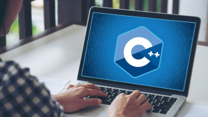

<p align="center">
  
</p>

<h1 align="center">Beginning C++ Programming — From Beginner to Beyond</h1>

<p align="center">
  Coursework, hands-on code examples, and structured study notes for the Udemy course <strong>Beginning C++ Programming - From Beginner to Beyond</strong>.
</p>

<p align="center">
  
  
  
</p>

<p align="center">
  <strong>English</strong> | <a href="./README.zh-CN.md">简体中文</a>
</p>

---

## 📖 About This Repository

My coursework and projects from the Udemy course *Beginning C++ Programming - From Beginner to Beyond* — covering C++ fundamentals, control flow, functions, arrays and vectors, pointers and references, object-oriented programming, inheritance and polymorphism, STL, templates, exception handling, file I/O, and modern C++ features.

Each section in this repository is organized to pair **conceptual notes** with **runnable code**, making it easy to review core mechanics, language edge cases, and practical exercises later.

---

## 🎬 Course Videos

You can watch the course lectures on Bilibili for free:

* **Part 1:** [https://www.bilibili.com/video/BV1E4W36oEJv/](https://www.bilibili.com/video/BV1E4W36oEJv/)
* **Part 2:** [https://www.bilibili.com/video/BV16KWZ6oEYE/](https://www.bilibili.com/video/BV16KWZ6oEYE/)

---

## 🗂️ Course Syllabus & Resources

| Section | Topic | Notes | Code |
| :---: | :--- | :---: | :---: |
| **01** | Introduction | Note | Code |
| **02** | Installation and Setup | Note | Code |
| **04** | Getting Started | Note | [Code](./04%20-%20Getting%20Started) |
| **05** | Structure of a C++ Program | [Note](./cpp-notes/05.%20Structure%20of%20a%20C%2B%2B%20Program) | [Code](./05%20-%20Structure%20of%20a%20C%2B%2B%20Program) |
| **06** | Variables and Constants | [Note](./cpp-notes/06.%20Variables%20and%20Constants) | [Code](./06%20-%20Variables%20and%20Constants) |
| **07** | Arrays and Vectors | [Note](./cpp-notes/07.%20Arrays%20and%20Vectors) | [Code](./07%20-%20Arrays%20and%20Vectors) |
| **08** | Statements and Operators | [Note](./cpp-notes/08.%20Statements%20and%20Operators) | [Code](./08%20-%20Statements%20and%20Operators) |
| **09** | Controlling Program Flow | [Note](./cpp-notes/09.%20Controlling%20Program%20Flow) | [Code](./09%20-%20Controlling%20Program%20Flow) |
| **10** | Characters and Strings | [Note](./cpp-notes/10.%20Characters%20and%20Strings) | [Code](./10%20-%20Characters%20and%20Strings) |
| **11** | Functions | [Note](./cpp-notes/11.%20Functions) | [Code](./11%20-%20Functions) |
| **12** | Pointers and References | [Note](./cpp-notes/12.%20Pointers%20and%20References) | [Code](./12%20-%20Pointers%20and%20References) |
| **13** | OOP — Classes and Objects | [Note](./cpp-notes/13.%20OOP%20-%20Classes%20and%20Objects) | Code |
| **14** | Operator Overloading | [Note](./cpp-notes/14.%20Operator%20Overloading) | Code |
| **15** | Inheritance | [Note](./cpp-notes/15.%20Inheritance) | Code |
| **16** | Polymorphism | [Note](./cpp-notes/16.%20Polymorphism) | Code |
| **17** | Smart Pointers | [Note](./cpp-notes/17.%20Smart%20Pointers) | Code |
| **18** | Exception Handling | [Note](./cpp-notes/18.%20Exception%20Handling) | Code |
| **19** | I/O and Streams | [Note](./cpp-notes/19.%20IO%20and%20Streams) | Code |
| **20** | The Standard Template Library (STL) | [Note](./cpp-notes/20.%20The%20Standard%20Template%20Library%20%28STL%29) | Code |
| **21** | Lambda Expressions | [Note](./cpp-notes/21.%20Lambda%20Expressions) | Code |

---

## 🛠️ Build & Run

Compile any `.cpp` file with a modern C++ compiler (e.g., `g++` or `clang++`):

```bash
g++ -std=c++17 -Wall -Wextra main.cpp -o main
./main
```

---

## 📌 Disclaimer

This repository is for personal learning, note-taking, and code organization based on coursework from *Beginning C++ Programming - From Beginner to Beyond*. All course materials and original problem prompts belong to their respective creators.
